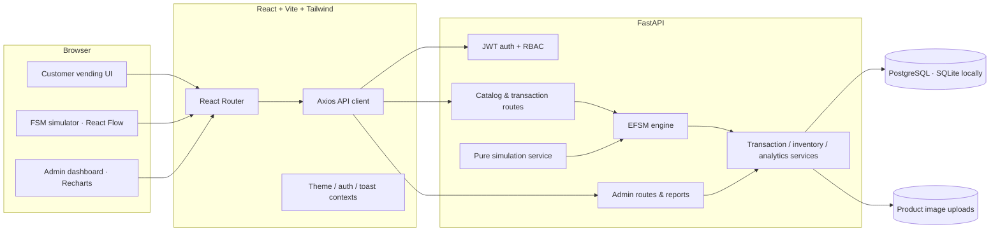

# SmartVend — Finite Automata Based Vending Machine Management System

SmartVend is a full-stack vending-machine operations platform where **every purchase is a
persisted Extended Finite State Machine (EFSM)**. Customers browse a live catalog, build a cart,
pay with simulated cash or UPI, receive change and a receipt. Operators manage stock, machines
and transactions. Admins additionally control the catalog, refunds, analytics and exports. A
public simulator lets anyone step the same automaton that the API executes in production.

> **Simulation notice:** payments and dispensing are software simulations. No payment gateway,
> coin acceptor, note validator or physical dispenser is controlled by this project.

---

## Table of contents

- [Feature tour](#feature-tour)
- [Architecture](#architecture)
- [Formal automaton](#formal-automaton)
- [Transition table](#transition-table)
- [Purchase lifecycle and guarantees](#purchase-lifecycle-and-guarantees)
- [Tech stack](#tech-stack)
- [Project structure](#project-structure)
- [Quick start (local)](#quick-start-local)
- [Docker Compose](#docker-compose)
- [Demo accounts](#demo-accounts)
- [API overview](#api-overview)
- [Testing](#testing)
- [Configuration](#configuration)
- [Money and data conventions](#money-and-data-conventions)
- [Design and security notes](#design-and-security-notes)

---

## Feature tour

### Customer vending UI (`/`, `/vending`)

- Machine selector, live catalog, search, category filter and stock indicators.
- Cart with quantity controls, due/change calculation and server-side validation.
- Simulated coin/note insertion (`₹1–₹20` coins, `₹10–₹2,000` notes) and simulated UPI.
- Live FSM trace rail showing every accepted transition while the purchase runs.
- Cancel-with-refund path, dispense simulation, change return and printable receipt modal.
- Receipt history persisted in `localStorage` and restored from the API by reference.

### Admin dashboard (`/admin`)

- Executive dashboard: revenue, purchases, ticket size, stock alerts, recent transactions,
  machine health and seven-day revenue chart.
- Product and category CRUD, image upload, activation toggles and archive-safe deletion.
- Inventory by machine, restock, low-stock threshold editing, bulk inventory plans and
  stock-movement log.
- Transaction search/filter/detail with complete FSM state log, payments, refunds and
  role-gated refund action.
- Machine CRUD, online/offline/maintenance status, alerts and alert resolution.
- Analytics with Recharts: revenue, product performance, category mix, payment split, status
  breakdown, inventory value and machine performance. CSV and PDF report exports.

### Public FSM simulator (`/simulator`)

- React Flow graph generated from `GET /fsm/model` — all 13 states and 29 edges.
- Active state and most recent edge highlighting, labelled events and transition tooltips.
- Step, auto-run, pause and reset; custom event sequences in a live runner.
- Rejected transitions explain the guard failure instead of silently failing.
- Context inspector for balance, cart total, payment method, stock and terminal status.
- Every step calls the real backend simulation endpoint; the diagram is not a mock.

### Roles

| Capability | Admin | Operator | Public |
| --- | :---: | :---: | :---: |
| Browse catalog / buy | ✓ | ✓ | ✓ |
| Simulator | ✓ | ✓ | ✓ |
| View dashboard, inventory, transactions, machines | ✓ | ✓ | — |
| Restock, thresholds, machine status, resolve alerts | ✓ | ✓ | — |
| Refund completed transaction | ✓ | — | — |
| Product/category create, edit, delete | ✓ | — | — |
| Create/edit machines | ✓ | — | — |
| Analytics and CSV/PDF reports | ✓ | ✓ | — |

---

## Architecture



The backend owns all business rules. The browser never decides whether a transition is legal:
it requests an operation, the API loads the persisted transaction, reconstructs the EFSM
context, evaluates the guard, applies the action, appends a `StateLog`, and commits atomically.

---

## Formal automaton

The canonical model is available at `GET /api/v1/fsm/model`.

```
M = (Q, Σ, δ, q₀, F, C)
```

| Symbol | Meaning |
| --- | --- |
| `Q` | 13 states, listed below |
| `Σ` | 20 input events |
| `δ` | 29 partial transitions; deterministic for a given extended context |
| `q₀` | `IDLE` |
| `F` | `{COMPLETED, CANCELLED}` |
| `C` | balance, cart, total, payment method, reservation, dispense and refund context |

### States — Q (13)

| State | Meaning |
| --- | --- |
| `IDLE` | Awake, waiting for a customer or maintenance mode. |
| `PRODUCT_SELECTED` | A cart is attached and may still be edited. |
| `INVENTORY_CHECK` | Stock is being inspected and atomically reserved. |
| `OUT_OF_STOCK` | At least one line cannot be fulfilled. |
| `PAYMENT_PENDING` | Stock reserved; waiting for enough simulated funds. |
| `PAYMENT_ACCEPTED` | Balance covers the total; dispensing is unlocked. |
| `DISPENSING` | Simulated dispenser is releasing products. |
| `CHANGE_RETURN` | Products released; calculating/returning change. |
| `COMPLETED` | Successful terminal state; accepting state. |
| `CANCELLED` | Closed without an unrefunded charge; accepting state. |
| `REFUNDING` | Captured funds are being returned. |
| `ERROR` | Safe terminal error after payment/hardware failure. |
| `MAINTENANCE` | Service mode; customer transactions are blocked. |

### Events — Σ (20)

`SELECT_PRODUCT`, `CONFIRM_PRODUCT`, `CHECK_STOCK`, `STOCK_AVAILABLE`, `STOCK_UNAVAILABLE`,
`INSERT_COIN`, `INSERT_NOTE`, `PAYMENT_SUCCESS`, `PAYMENT_FAILED`, `INSUFFICIENT_AMOUNT`,
`SUFFICIENT_AMOUNT`, `DISPENSE_PRODUCT`, `DISPENSE_SUCCESS`, `DISPENSE_FAILURE`,
`RETURN_CHANGE`, `CANCEL_TRANSACTION`, `PROCESS_REFUND`, `RESET_MACHINE`,
`ENTER_MAINTENANCE`, `EXIT_MAINTENANCE`.

Emitted events such as `STOCK_AVAILABLE`, `INSUFFICIENT_AMOUNT`, `SUFFICIENT_AMOUNT`,
`DISPENSE_SUCCESS` and `RETURN_CHANGE` are produced by the transaction service as it observes
the simulated environment; they are still evaluated and logged by the same transition table.

---

## Transition table

`δ` is partial: a `(state, event)` pair absent from the table is rejected as
`FSM_INVALIDTRANSITION`. Dynamic targets are marked with their guard-dependent alternatives.

| # | From | Event | To | Guard / action |
| ---: | --- | --- | --- | --- |
| 1 | `IDLE` | `SELECT_PRODUCT` | `PRODUCT_SELECTED` | Guard: non-empty valid cart. |
| 2 | `PRODUCT_SELECTED` | `CONFIRM_PRODUCT` | `INVENTORY_CHECK` | Guard: valid cart. |
| 3 | `PRODUCT_SELECTED` | `CHECK_STOCK` | `INVENTORY_CHECK` | Guard: valid cart. |
| 4 | `PRODUCT_SELECTED` | `CANCEL_TRANSACTION` | `CANCELLED` | No stock reserved. |
| 5 | `INVENTORY_CHECK` | `STOCK_AVAILABLE` | `PAYMENT_PENDING` | All lines reserved atomically. |
| 6 | `INVENTORY_CHECK` | `STOCK_UNAVAILABLE` | `OUT_OF_STOCK` | Reservation rolled back. |
| 7 | `INVENTORY_CHECK` | `CANCEL_TRANSACTION` | `CANCELLED` | Close before payment. |
| 8 | `OUT_OF_STOCK` | `RESET_MACHINE` | `IDLE` | Acknowledge failure. |
| 9 | `OUT_OF_STOCK` | `CANCEL_TRANSACTION` | `CANCELLED` | Close transaction. |
| 10 | `PAYMENT_PENDING` | `INSERT_COIN` | `PAYMENT_PENDING` | Guard: accepted coin; add balance. |
| 11 | `PAYMENT_PENDING` | `INSERT_NOTE` | `PAYMENT_PENDING` | Guard: accepted note; add balance. |
| 12 | `PAYMENT_PENDING` | `INSUFFICIENT_AMOUNT` | `PAYMENT_PENDING` | Guard: balance < total. |
| 13 | `PAYMENT_PENDING` | `SUFFICIENT_AMOUNT` | `PAYMENT_ACCEPTED` | Guard: balance ≥ total; mark paid. |
| 14 | `PAYMENT_PENDING` | `PAYMENT_SUCCESS` | `PAYMENT_ACCEPTED` | Guard: UPI covers total. |
| 15 | `PAYMENT_PENDING` | `PAYMENT_FAILED` | `ERROR` / `REFUNDING` | Dynamic: refund inserted cash, otherwise error. |
| 16 | `PAYMENT_PENDING` | `CANCEL_TRANSACTION` | `CANCELLED` / `REFUNDING` | Dynamic: refund if balance > 0. |
| 17 | `PAYMENT_ACCEPTED` | `DISPENSE_PRODUCT` | `DISPENSING` | Guard: fully paid. |
| 18 | `PAYMENT_ACCEPTED` | `CANCEL_TRANSACTION` | `REFUNDING` | Captured funds require refund. |
| 19 | `DISPENSING` | `DISPENSE_SUCCESS` | `CHANGE_RETURN` | Calculate change. |
| 20 | `DISPENSING` | `DISPENSE_FAILURE` | `REFUNDING` | Return funds; no charge. |
| 21 | `CHANGE_RETURN` | `RETURN_CHANGE` | `COMPLETED` | Accepting state. |
| 22 | `COMPLETED` | `RESET_MACHINE` | `IDLE` | Finalize receipt / next customer. |
| 23 | `COMPLETED` | `CANCEL_TRANSACTION` | `REFUNDING` | Guard: refundable captured funds. |
| 24 | `REFUNDING` | `PROCESS_REFUND` | `CANCELLED` | Guard: not already refunded; refund. |
| 25 | `CANCELLED` | `RESET_MACHINE` | `IDLE` | Close after cancel/refund. |
| 26 | `ERROR` | `CANCEL_TRANSACTION` | `CANCELLED` / `REFUNDING` | Dynamic refund path. |
| 27 | `ERROR` | `RESET_MACHINE` | `IDLE` | Acknowledge error. |
| 28 | `IDLE` | `ENTER_MAINTENANCE` | `MAINTENANCE` | Service mode. |
| 29 | `MAINTENANCE` | `EXIT_MAINTENANCE` | `IDLE` | Leave service mode. |

### Guards and context

The EFSM context is reconstructed from persisted rows before every step:

- `balance_paise` — accepted/inserted funds.
- `total_paise` — authoritative cart total computed from persisted line items.
- `items` — product, quantity and unit price snapshots.
- `payment_method` — `cash` or `upi`.
- `stock_reserved`, `dispensed`, `refunded_paise` and error state.

Guard failures return HTTP `409` with `code: FSM_GUARDREJECTED` and a human-readable reason.
Unknown `(state, event)` pairs return `FSM_INVALIDTRANSITION`. Both are shown by the simulator
and the customer UI.

---

## Purchase lifecycle and guarantees

1. **Create cart** — `POST /transactions` persists item snapshots and runs
   `IDLE → PRODUCT_SELECTED → INVENTORY_CHECK → PAYMENT_PENDING` (or `OUT_OF_STOCK`).
2. **Reserve stock** — conditional `UPDATE ... WHERE quantity - reserved_quantity >= n`
   statements reserve every line. Any short line rolls back earlier reservations.
3. **Pay** — cash inserts loop in `PAYMENT_PENDING`; a sufficient balance or simulated UPI
   success moves to `PAYMENT_ACCEPTED`. A UPI failure refunds inserted cash when present.
4. **Dispense** — `PAYMENT_ACCEPTED → DISPENSING → CHANGE_RETURN`; inventory is deducted only
   after simulated dispense success, with `InventoryLog` rows and low-stock alerts.
5. **Complete** — `RETURN_CHANGE` finalizes change/receipt and reaches `COMPLETED`.
6. **Recover** — cancelling or failing releases reservations and refunds captured funds via
   `REFUNDING → PROCESS_REFUND → CANCELLED`; admin refunds reuse the same path.
7. **Reset** — terminal states return to `IDLE` with `RESET_MACHINE`.

Server-side protections:

- Every accepted step appends a sequenced, timestamped `StateLog` with a context snapshot.
- Transaction `version` increments on each transition for optimistic awareness.
- `X-Idempotency-Key` makes create/payment/dispense retries safe; replaying returns the
  existing result instead of double-charging or double-dispensing.
- Unique constraints and state guards prevent duplicate payment records and duplicate
  dispensing.
- All money is integer **paise**; no floating-point arithmetic is used for totals.
- API validation, machine status, stock, balance, role and cart ownership are re-checked on the
  server for every action.

---

## Tech stack

**Frontend:** React 18, Vite 6, Tailwind CSS 3, React Router 6, React Flow 11, Recharts 2,
Axios, Lucide icons, Vitest, React Testing Library, jsdom.

**Backend:** FastAPI 0.115, SQLAlchemy 2, Pydantic 2, PyJWT, PBKDF2-HMAC-SHA256 password
hashing (600,000 iterations), Alembic, ReportLab, Pytest, HTTPX.

**Data:** PostgreSQL 16 in Docker; SQLite for zero-configuration local development and tests.

---

## Project structure

```text
.
├── backend/
│   ├── alembic/                 # migration environment + initial schema
│   ├── app/
│   │   ├── automaton/           # states, events, δ table, engine, context
│   │   ├── core/                # settings, security, dependencies
│   │   ├── database/            # engine/session/base
│   │   ├── models/              # SQLAlchemy models
│   │   ├── routes/              # public + admin REST routers
│   │   ├── schemas/             # Pydantic request/response models
│   │   ├── services/            # transactions, inventory, analytics, reports, seed
│   │   └── main.py              # FastAPI app, CORS, handlers, static uploads
│   ├── static/uploads/          # uploaded product images
│   ├── tests/                   # Pytest suite (31 tests)
│   ├── Dockerfile
│   └── requirements.txt
├── frontend/
│   ├── src/
│   │   ├── components/          # shared UI, protected route, logo
│   │   ├── context/             # auth, theme, toast
│   │   ├── features/catalog/    # product/category modals
│   │   ├── layouts/             # admin shell
│   │   ├── pages/               # customer, admin, public simulator/404
│   │   ├── services/            # Axios API wrappers
│   │   ├── tests/               # Vitest + Testing Library (34 tests)
│   │   └── utils/               # INR/date formatting, FSM labels
│   ├── Dockerfile
│   ├── nginx.conf
│   └── package.json
├── docker-compose.yml
├── .env.example                 # Compose environment template
└── README.md
```

---

## Quick start (local)

### Prerequisites

- Python 3.11+ (3.12 recommended)
- Node.js 20+ and npm 10+
- No PostgreSQL needed locally: the default is SQLite at `backend/smartvend.db`.

### 1. Backend

```bash
# from the repository root
python -m venv .venv

# Windows PowerShell
.\.venv\Scripts\Activate.ps1
# macOS/Linux
# source .venv/bin/activate

pip install -r backend/requirements.txt
cd backend
copy .env.example .env        # Windows
# cp .env.example .env        # macOS/Linux
```

For the zero-config SQLite path, replace `DATABASE_URL` in `backend/.env` with:

```dotenv
DATABASE_URL=sqlite:///./smartvend.db
```

Then create the schema and run:

```bash
python -m alembic upgrade head
uvicorn app.main:app --reload --port 8000
```

The API is at `http://localhost:8000`, docs at `http://localhost:8000/docs`.
Demo data (accounts, categories, 12 products, 3 machines, sample history) is seeded on startup
when `SEED_DEMO_DATA=true`.

### 2. Frontend

In a second terminal:

```bash
cd frontend
copy .env.example .env
npm install
npm run dev
```

Open `http://localhost:5173`. Vite proxies `/api` and `/static` to `http://localhost:8000`.
The customer UI is `/`, the simulator is `/simulator`, and admin login is `/admin/login`.

### 3. Production build (without Docker)

```bash
cd frontend
npm run build
npm run preview
```

Remember to point `VITE_API_URL` at the deployed API (including `/api/v1`).

---

## Docker Compose

Docker Compose runs PostgreSQL 16, applies Alembic migrations, starts FastAPI, builds the React
app and serves it through nginx.

```bash
copy .env.example .env       # Windows
# cp .env.example .env       # macOS/Linux
# edit SECRET_KEY and POSTGRES_PASSWORD first

docker compose up --build -d
```

| Service | URL |
| --- | --- |
| Web app | `http://localhost:8080` |
| API / Swagger | `http://localhost:8000/docs` |
| Health check | `http://localhost:8000/health` |

The nginx container proxies `/api/` and `/static/` to the backend, so the browser uses
same-origin requests. PostgreSQL data and uploaded images persist in named volumes. Stop with
`docker compose down`; add `-v` only when you intend to delete the database volume.

> Docker is optional. The authoring environment did not have Docker installed, so the Compose
> stack is provided as configuration and should be smoke-tested on a Docker-capable host.

---

## Demo accounts

| Role | Email | Password |
| --- | --- | --- |
| Administrator | `admin@smartvend.in` | `Admin@123` |
| Operator | `operator@smartvend.in` | `Operator@123` |

Change these credentials and `SECRET_KEY` before exposing the app publicly.

Seeded machines:

| Code | Name | Status |
| --- | --- | --- |
| `SV-MUM-01` | Nexus One | online |
| `SV-BLR-02` | Indiranagar Express | online |
| `SV-DEL-03` | Harbour Point | maintenance |

---

## API overview

Base path: `/api/v1`. Interactive OpenAPI documentation is available at `/docs`.

### Public

| Method | Path | Purpose |
| --- | --- | --- |
| `GET` | `/health` (root) | Liveness + database connectivity. |
| `GET` | `/catalog?machine_id=` | Available products and stock for a machine. |
| `GET` | `/catalog/machines` | Public machine list and statuses. |
| `POST` | `/transactions` | Create cart; runs selection/inventory FSM steps. |
| `GET` | `/transactions/{reference}` | Status, items, payments, refunds and state log. |
| `GET` | `/transactions/{reference}/receipt` | Digital receipt. |
| `POST` | `/transactions/{reference}/payments` | Simulated cash coin/note or UPI payment. |
| `POST` | `/transactions/{reference}/dispense` | Simulated dispense and finish. |
| `POST` | `/transactions/{reference}/cancel` | Cancel with automatic refund path. |
| `POST` | `/transactions/{reference}/reset` | `RESET_MACHINE` to `IDLE`. |
| `GET` | `/transactions/history?refs=...` | Restore receipts by comma-separated references. |
| `GET` | `/fsm/model` | Complete formal automaton model. |
| `POST` | `/fsm/simulate/step` | Pure one-step simulation; nothing persisted. |

### Authentication

| Method | Path | Purpose |
| --- | --- | --- |
| `POST` | `/auth/login` | JWT access token + user profile. |
| `GET` | `/auth/me` | Current signed-in user. |

### Admin / operator

| Method | Path | Purpose |
| --- | --- | --- |
| `GET` | `/admin/analytics/dashboard` | Dashboard metrics and chart series. |
| `GET` | `/admin/analytics/revenue?period=daily\|weekly\|monthly` | Revenue time series. |
| `GET` | `/admin/analytics/products` | Best/least-selling products. |
| `GET` | `/admin/analytics/categories` | Revenue by category. |
| `GET` | `/admin/analytics/payments` | Payment-method split. |
| `GET` | `/admin/analytics/statuses` | FSM state distribution. |
| `GET` | `/admin/analytics/inventory` | Inventory value and fill rates. |
| `GET` | `/admin/analytics/machines` | Machine performance. |
| `GET` | `/admin/reports/export?format=csv\|pdf&report_type=summary\|transactions\|products\|inventory` | Download report. |
| `GET` | `/admin/categories`, `/admin/products` | Catalog management lists. |
| `POST/PATCH/DELETE` | `/admin/categories...`, `/admin/products...` | Catalog CRUD (admin). |
| `POST` | `/admin/uploads/image` | JPEG/PNG/WebP upload, max 5 MB. |
| `GET` | `/admin/inventory`, `/summary`, `/logs` | Inventory, totals, movement log. |
| `POST` | `/admin/inventory/{id}/restock` | Add stock. |
| `PATCH` | `/admin/inventory/{id}/threshold` | Edit low-stock threshold. |
| `POST` | `/admin/inventory/bulk` | Apply an inventory plan. |
| `GET` | `/admin/transactions`, `/refunds` | Search transactions and refunds. |
| `GET` | `/admin/transactions/{reference}` | Full transaction + FSM detail. |
| `POST` | `/admin/transactions/{reference}/refund` | Admin refund through the FSM (admin). |
| `GET/POST/PATCH` | `/admin/machines...` | Machine management and status. |
| `GET` | `/admin/alerts` | Machine alerts. |
| `POST` | `/admin/alerts/{id}/resolve` | Resolve alert. |

---

## Testing

### Backend — Pytest

```bash
cd backend
..\.venv\Scripts\python.exe -m pytest tests -q
```

Coverage includes the 13/20/29 model, invalid and guard-rejected transitions, simulation,
denominations, cash/UPI happy paths, insufficient funds, out-of-stock atomic rollback,
cancellation/refund, UPI failure, dispense failure, idempotency, duplicate protection,
maintenance mode, RBAC, catalog/inventory CRUD, logs, transaction search, analytics, CSV/PDF
exports, receipts and state-log continuity.

Tests run against an isolated SQLite database with a deterministic per-test seed.

### Frontend — Vitest / React Testing Library

```bash
cd frontend
npm test
```

Covers INR/date formatting, API error extraction, token storage, shared UI components, modal
behaviour, dark/light theme persistence, protected-route RBAC and the admin login flow.

### Database migration check

```bash
cd backend
$env:DATABASE_URL='sqlite:///./alembic_verify.db'
..\.venv\Scripts\python.exe -m alembic upgrade head
..\.venv\Scripts\python.exe -m alembic check
```

`alembic check` should report **“No new upgrade operations detected.”**

---

## Configuration

### Backend (`backend/.env`)

| Variable | Default | Description |
| --- | --- | --- |
| `SECRET_KEY` | dev placeholder | JWT signing key; use 32+ random characters. |
| `ALGORITHM` | `HS256` | JWT algorithm. |
| `ACCESS_TOKEN_EXPIRE_MINUTES` | `720` | Token lifetime. |
| `DATABASE_URL` | `sqlite:///./smartvend.db` | SQLAlchemy URL. |
| `CORS_ORIGINS` | localhost dev origins | Comma-separated browser origins. |
| `ENVIRONMENT` | `development` | Shown by `/health`. |
| `DISPENSER_MODE` | `simulation` | Dispensing adapter mode. |
| `SEED_DEMO_DATA` | `true` | Seed demo catalog/users/machines. |

### Frontend (`frontend/.env`)

| Variable | Default | Description |
| --- | --- | --- |
| `VITE_API_URL` | `http://localhost:8000/api/v1` | API base URL used by Axios. |

For Docker, copy the root `.env.example` to `.env`. It configures PostgreSQL credentials,
`SECRET_KEY`, CORS origins and seed behaviour; the frontend build receives
`VITE_API_URL=/api/v1` and nginx proxies to the backend service.

---

## Money and data conventions

- **All persisted money is integer paise.** `₹1 = 100 paise`. The UI converts at the boundary.
- Accepted **coins:** `₹1, ₹2, ₹5, ₹10, ₹20` (100–2,000 paise).
- Accepted **notes:** `₹10, ₹20, ₹50, ₹100, ₹200, ₹500, ₹1,000, ₹2,000` (1,000–200,000 paise).
- A `₹50` coin is rejected with `FSM_GUARDREJECTED`; it is a note denomination, not a coin.
- Timestamps are stored in UTC; dates are formatted as `en-IN` in the UI.
- Product images are served from `/static/uploads/...`; uploads are limited to JPEG/PNG/WebP
  and 5 MB.

---

## Design and security notes

- **RBAC** is enforced by FastAPI dependencies (`require_staff`, `require_admin`), not just by
  hiding UI controls. Operators cannot refund or mutate the catalog/machines.
- **Password hashing** uses PBKDF2-HMAC-SHA256 with 600,000 iterations and a per-user salt.
- **JWT** is sent with `Authorization: Bearer`; the client clears stale tokens on `401` and
  broadcasts an unauthorized event so the auth context can reset.
- **Uploads** validate MIME type, size and emptiness, generate random filenames, and never trust
  the client-supplied filename.
- **SQL injection** is avoided through SQLAlchemy expressions and bound parameters.
- **CORS** is allow-listed; the Docker frontend avoids cross-origin calls via nginx proxying.
- **Error handling** returns consistent `{detail, code, errors?}` payloads and never leaks
  stack traces. Unhandled exceptions roll back the database session.
- **Idempotency** keys plus state guards protect retries from duplicate charges or dispenses.
- **Reset paths** exist for every non-accepting state; refunds reuse `REFUNDING` rather than
  mutating terminal rows silently.
- The UI has no fake live data: dashboards, analytics, simulator and customer flows all read
  from persisted API data or the real simulation endpoint.

### Known scope limits

- Payment and dispensing hardware are deliberately simulated; `DISPENSER_MODE=simulation`.
- Email/SMS receipts and external object storage are out of scope.
- The app exposes machine/operator management, not multi-tenant organisation accounts.
- Docker configuration is not executed in the authoring environment; verify on a host with
  Docker Engine 24+ / Compose v2.
